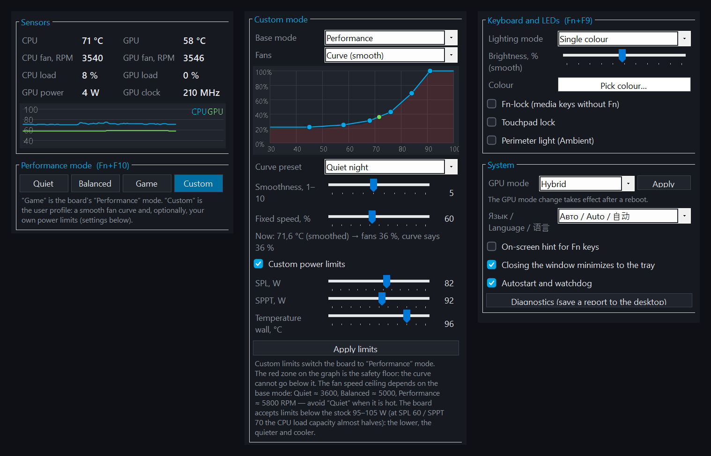

<p align="center"></p>

<h1 align="center">MRID6 Helper</h1>

<p align="center"><b>A tiny G-Helper alternative for MECHREVO Jiaolong (MRID6) laptops</b><br>
performance modes · smooth fan curve · CPU power limits · keyboard lighting · temperatures and fan RPM<br>
a single ≈130 KB executable, no installer, no dependencies</p>

<p align="center"><a href="README.md">Русский</a> · <a href="README.zh-CN.md">中文</a> · <a href="docs/PROTOCOL.md">Board protocol (RU)</a> · <a href="../../releases/latest">Download</a></p>

<p align="center"></p>

G-Helper targets ASUS ROG laptops. On a MECHREVO Jiaolong it only half works, shows no temperatures or fan speeds, and — while running —
keeps resetting the performance mode to "Balanced". **MRID6 Helper** talks to this laptop's own platform interface (Bitland ACPI/WMI) and does
what neither G-Helper nor the stock "蛟龙游戏控制中心" can.

## Features

* **Sensors**: CPU and GPU temperature, **RPM of both fans**, load, GPU power/clock, **temperature graph**. The tray icon shows the temperature
  as a number and the mode as its colour.
* **Modes** Quiet / Balanced / Game (= the board's "Performance") / **Custom**, kept in sync with **Fn+F10** both ways.
* **Custom mode**
  * **Smooth fan curve** — 6 draggable points, presets (Balanced / Quiet night / Cooler), a smoothing slider. The board's own automatic fan
    control is stepwise ("fast, then slow, then fast" — audible at night). Here the temperature is smoothed (rises fast, falls slowly) and the fan
    speed ramps up quickly but comes down very slowly.
  * **Safety floor** — the red zone on the graph: the curve cannot go below it; ≥ 92 °C is always 100 %.
  * **Custom CPU power limits** (SPL / SPPT / temperature wall). Default: "Performance" with reduced limits (SPL 82 / SPPT 92 W, wall 90 °C).
    The board accepts values below the vendor's 95–105 W sliders: at SPL 60 / SPPT 70 the CPU load capacity drops by about half.
  * Base board mode, fixed fan speed or the board's automatic control — your choice.
* **Keyboard lighting**: off / **smooth rainbow** / single colour / the board's own mode, colour picker, **smooth 0–100 % brightness**
  (perceptual), Fn-lock, touchpad lock, perimeter light.
* **GPU mode** Hybrid / Discrete-only (MUX), effective after a reboot.
* **Autostart with a watchdog**: a scheduled task starts the app at logon and **checks every minute that it is alive**; works on battery,
  elevated without a UAC prompt. The tray's "Exit (do not restart until reboot)" is a deliberate exit.
* **Three UI languages**: Russian, English, 中文 (Simplified) — detected from the Windows language, switchable in the System section (applied after a restart; the app offers to restart itself).
* Desktop shortcut without the UAC shield (`tools/make-shortcut.ps1`), full-height window by default, a built-in on-hardware self-test.

## Install

1. Download `Mrid6Helper-<version>-win-x64.zip` from [Releases](../../releases/latest) and unpack it to a **permanent folder** (autostart remembers the path).
2. Run `Mrid6Helper.exe` and accept the UAC prompt (the board interface is available to administrators only). SmartScreen may warn about an
   unknown publisher — the program is not code-signed; the SHA-256 and the VirusTotal result are in the release notes.
3. Optionally enable **"Autostart and watchdog"** (System section) and create the shortcut: `powershell -File tools\make-shortcut.ps1`.

**Requirements**: Windows 10/11 x64 with .NET Framework 4.8 (built in) and a MECHREVO Jiaolong MRID6. Tested on `MRID6-23`, BIOS `MRID6_23_V36`,
Ryzen 9 7845HX + RTX 4070 Laptop. Other Bitland/MECHREVO models exposing the same `MICommonInterface` may work — run
`Mrid6Helper.exe --probe report.txt` and attach the report to an [issue](../../issues).

## Good to know

* **Close G-Helper.** It is not designed for this board and, while running, spontaneously switches the mode back to "Balanced".
* The maximum fan speed depends on the board mode: Quiet ≈ 3600, Balanced ≈ 5000, Game ≈ 5800 RPM. Avoid "Quiet" as the base mode when hot.
* If the app is killed, the fans keep the last percentage until the watchdog restarts it (up to a minute); the safety floor prevents a low
  speed under heat. A normal exit gives the fans back to the board's automatic control.
* Power limits and the GPU mode are your call. The app writes only commands the vendor's own utility uses.
* **Unofficial** project, made by reverse-engineering the interface for interoperability with the author's own hardware, provided "as is"
  (see [LICENSE](LICENSE)). Not affiliated with MECHREVO / Shenzhen Bitland. MECHREVO's name and logo are trademarks of their owners, used here
  only to identify compatible hardware.

## Command line

```
Mrid6Helper.exe                       window
Mrid6Helper.exe --tray                start in the tray
Mrid6Helper.exe --probe report.txt    read-only: the board's answers to every Get command
Mrid6Helper.exe --selftest report.txt run the whole feature set against the hardware (state is restored)
Mrid6Helper.exe --autostart on|off    create / delete the autostart task
```

## How it works

The platform interface is WMI `root\WMI` → `MICommonInterface.MiInterface(InData[32])`; the commands (mode, RPM, CPU temperature, limits 0x17,
lighting, fixed fan speed) and measurements are documented in [docs/PROTOCOL.md](docs/PROTOCOL.md) (Russian). The hardware has no fan curve —
only a fixed percentage — so the app executes the curve itself (`src/FanCurve.cs`). GPU temperature comes from NVML, CPU temperature from the EC sensor.

## Build

Only the Roslyn compiler from Visual Studio Build Tools is needed (nothing is downloaded): `powershell -File build.ps1`.

## License

[MIT](LICENSE)
