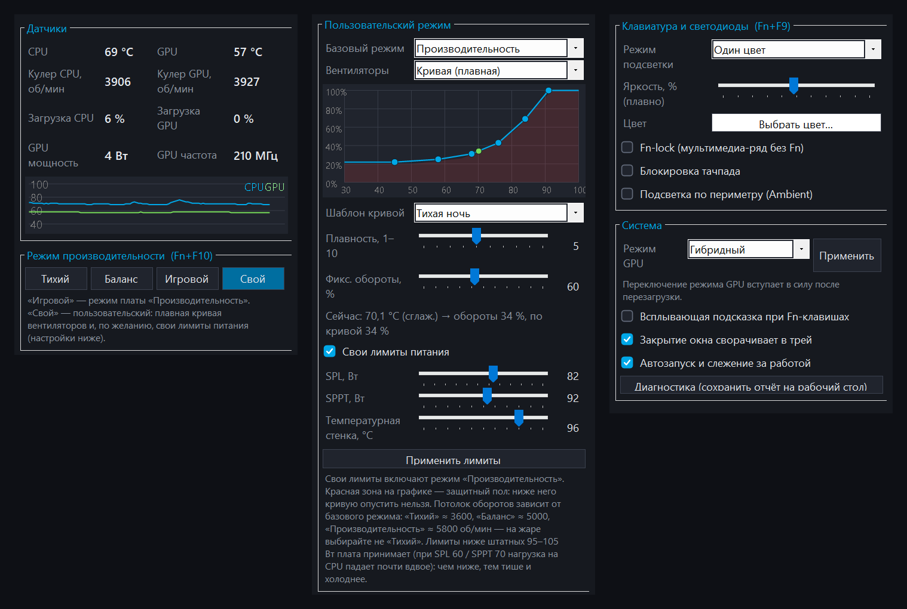
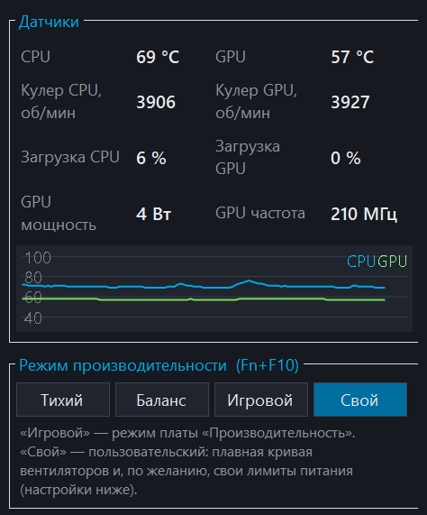
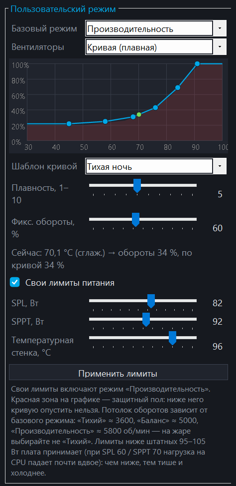
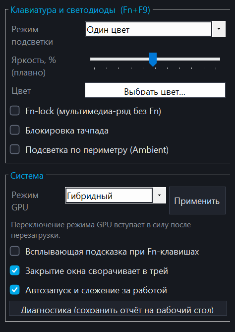

<p align="center"></p>

<h1 align="center">MRID6 Helper</h1>

<p align="center"><b>Лёгкая замена G-Helper для ноутбуков MECHREVO Jiaolong (MRID6)</b><br>
режимы производительности · плавная кривая вентиляторов · лимиты питания CPU · подсветка клавиатуры · температуры и обороты<br>
один файл ≈ 115 КБ, без установщика и зависимостей</p>

<p align="center"><a href="README.en.md">English</a> · <a href="docs/PROTOCOL.md">Протокол платы</a> · <a href="docs/JOURNAL.md">Журнал разработки</a> · <a href="../../releases/latest">Скачать</a></p>

<p align="center"></p>

G-Helper написан под ноутбуки ASUS ROG. На MECHREVO Jiaolong он работает наполовину, не показывает температуры и обороты кулеров, а пока
запущен, ещё и сам возвращает режим «Баланс». **MRID6 Helper** разговаривает с платформенным интерфейсом именно этого ноутбука
(ACPI/WMI Bitland) и умеет то, чего нет ни у G-Helper, ни у штатной «蛟龙游戏控制中心».

## Возможности

* **Датчики**: температура CPU и GPU, **обороты обоих кулеров**, загрузка, мощность и частота GPU, **график температур**. Значок в трее
  показывает температуру цифрой, а цветом — режим (тихий — синий, баланс — зелёный, игровой — оранжевый, «Свой» — фиолетовый);
  перегрев — красная рамка.
* **Режимы** Тихий / Баланс / Игровой (= «Производительность» платы) / **Свой**. Синхронизируются с **Fn+F10** в обе стороны.
* **Пользовательский режим («Свой»)**
  * **Плавная кривая вентиляторов** — 6 точек, тянутся мышью; шаблоны «Баланс», «Тихая ночь», «Прохладнее»; ползунок плавности. Штатная
    автоматика платы работает ступенчато («то быстро, то медленно» — шум по ночам). Здесь температура сглаживается (растёт быстро, спадает
    медленно), обороты нарастают быстро и снижаются очень медленно.
  * **Защитный пол** — красная зона на графике: ниже неё кривую опустить нельзя; при ≥ 92 °C всегда 100 %.
  * **Свои лимиты питания CPU** (SPL / SPPT / температурная стенка). По умолчанию — «Производительность» со сниженными лимитами
    (SPL 82 / SPPT 92 Вт, стенка 90 °C). Плата принимает и значения ниже штатных 95–105 Вт: при SPL 60 / SPPT 70 нагрузка на CPU падает почти вдвое.
  * Базовый режим платы, фиксированные обороты или автоматика платы — на выбор.
* **Подсветка клавиатуры**: Выкл / **плавная радуга** / один цвет / авто-режим платы, выбор цвета, **плавная яркость 0–100 %** (по
  воспринимаемой яркости), Fn-lock, блокировка тачпада, подсветка по периметру.
* **Режим GPU** Гибридный / Только дискретная (MUX) — вступает в силу после перезагрузки.
* **Автозапуск со слежением**: задача планировщика запускает программу при входе и **раз в минуту проверяет, что она жива**; работает от
  батареи, с повышенными правами без запроса UAC. Пункт трея «Выход (не запускать до перезагрузки)» — умышленный выход.
* **Ярлык без щита UAC** (`tools/make-shortcut.ps1`), окно по умолчанию на всю высоту экрана, встроенный самотест на железе.

<p align="center">



</p>

## Установка

1. Скачайте `Mrid6Helper-<версия>-win-x64.zip` со страницы [Releases](../../releases/latest) и распакуйте в **постоянную папку**
   (автозапуск запоминает путь к файлу).
2. Запустите `Mrid6Helper.exe` и подтвердите запрос UAC (доступ к интерфейсу платы возможен только от администратора).
   Windows SmartScreen может предупредить о «неизвестном издателе» — программа не подписана цифровой подписью; хэш и проверка на
   VirusTotal указаны в описании релиза.
3. По желанию включите **«Автозапуск и слежение за работой»** (раздел «Система») и создайте ярлык: `powershell -File tools\make-shortcut.ps1`.

**Требования**: Windows 10/11 x64 с .NET Framework 4.8 (есть в системе), ноутбук MECHREVO Jiaolong MRID6. Проверено на `MRID6-23`,
BIOS `MRID6_23_V36`, Ryzen 9 7845HX + RTX 4070 Laptop. Для других моделей Bitland/MECHREVO с тем же интерфейсом (`MICommonInterface`)
может подойти — запустите `Mrid6Helper.exe --probe отчёт.txt` и пришлите отчёт в [Issues](../../issues).

## Важно знать

* **Закройте G-Helper** — он не рассчитан на эту плату и, пока запущен, самопроизвольно возвращает режим «Баланс». Со штатной
  «蛟龙游戏控制中心» тоже лучше не менять настройки одновременно.
* Максимум оборотов зависит от режима платы: «Тихий» ≈ 3600, «Баланс» ≈ 5000, «Игровой» ≈ 5800 об/мин. На жаре не выбирайте базовый «Тихий».
* Если программу убить принудительно, вентиляторы остаются на последнем проценте, пока её не перезапустит наблюдатель (до минуты);
  защитный пол не даёт оставить малые обороты на жаре. При штатном выходе вентиляторы возвращаются автоматике платы.
* Лимиты питания и режим GPU — на ваше усмотрение. Программа пишет только команды, которые знает штатная утилита вендора.
* Проект **неофициальный**, сделан обратной разработкой интерфейса для совместимости с собственным оборудованием, поставляется «как есть»
  (см. [LICENSE](LICENSE)). Не связан с MECHREVO / Shenzhen Bitland. Название и знак MECHREVO — товарные знаки их владельцев,
  используются только для обозначения совместимого оборудования.

## Командная строка

```
Mrid6Helper.exe                       окно
Mrid6Helper.exe --tray                сразу в трей
Mrid6Helper.exe --probe отчёт.txt     только чтение: ответы платы на все Get-команды
Mrid6Helper.exe --selftest отчёт.txt  прогон всего функционала с проверкой по железу (всё возвращается как было)
Mrid6Helper.exe --autostart on|off    создать/удалить задачу автозапуска
```

Служебные: `--mark-exit` / `--clear-exit`, `--install-open-task`, `--script вход выход` (лаборатория: `G` / `S` / `W` / `R` / `B`), `--shot файл.png [сек]`.

## Как это устроено

Платформенный интерфейс — WMI `root\WMI` → `MICommonInterface.MiInterface(InData[32])`; команды (режим, RPM, температура CPU, лимиты
0x17, подсветка, фиксированные обороты) и замеры описаны в [docs/PROTOCOL.md](docs/PROTOCOL.md). Железо не умеет кривую вентиляторов —
только фиксированный процент, поэтому кривую исполняет приложение (`src/FanCurve.cs`). Температуры GPU — NVML, CPU — датчик EC.

## Сборка

Нужен только компилятор Roslyn из Visual Studio Build Tools (ничего не скачивается):

```
powershell -File build.ps1
```

Значок рисуется скриптом `tools/make-icon.ps1` (знак MECHREVO, обведённый по логотипу на крышке ноутбука).

## Лицензия

[MIT](LICENSE)
