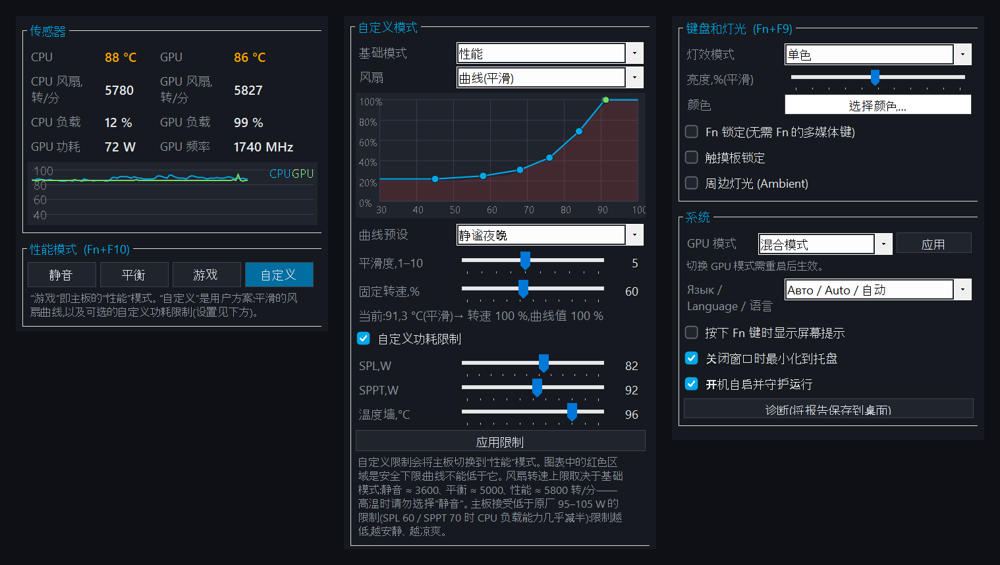

<p align="center"></p>

<h1 align="center">MRID6 Helper</h1>

<p align="center"><b>机械革命蛟龙(MRID6)笔记本的轻量级 G-Helper 替代品</b><br>
性能模式 · 平滑风扇曲线 · CPU 功耗限制 · 键盘灯光 · 温度与风扇转速<br>
单个约 130 KB 的可执行文件,无需安装,无依赖</p>

<p align="center"><a href="README.md">Русский</a> · <a href="README.en.md">English</a> · <a href="docs/PROTOCOL.md">主板协议(俄文)</a> · <a href="../../releases/latest">下载</a></p>

<p align="center"></p>

G-Helper 是为华硕 ROG 笔记本编写的,在机械革命蛟龙上只能部分工作,不显示温度和风扇转速,运行时还会擅自把性能模式改回“平衡”。
**MRID6 Helper** 直接与这台笔记本自己的平台接口(Bitland ACPI/WMI)通信,实现了 G-Helper 和原厂“蛟龙游戏控制中心”都没有的功能。

## 功能

* **传感器**:CPU / GPU 温度、**两个风扇的转速**、负载、GPU 功耗与频率、**温度曲线图**。托盘图标用数字显示温度,用颜色表示模式。
* **模式**:静音 / 平衡 / 游戏(即主板的“性能”)/ **自定义**,与 **Fn+F10** 双向同步。
* **自定义模式**
  * **平滑风扇曲线**——6 个可拖动的点、预设(平衡 / 静谧夜晚 / 更凉爽)、平滑度滑块。主板自带的风扇自动控制是“阶梯式”的
    (忽快忽慢,夜里很吵)。这里温度会被平滑处理(升得快、降得慢),转速上升迅速、下降非常缓慢。
  * **安全下限**——图上的红色区域:曲线不能低于它;≥ 92 °C 时始终 100%。
  * **自定义 CPU 功耗限制**(SPL / SPPT / 温度墙)。默认:“性能”模式 + 降低的限制(SPL 82 / SPPT 92 W,温度墙 90 °C)。
    主板接受低于原厂 95–105 W 的数值:SPL 60 / SPPT 70 时,CPU 负载能力几乎减半。
  * 基础模式、固定转速或主板自动控制,任选。
* **键盘灯光**:关闭 / **平滑彩虹** / 单色 / 主板自带模式、取色、**0–100% 平滑亮度**(按感知亮度)、Fn 锁定、触摸板锁定、周边灯光。
* **GPU 模式**:混合 / 仅独显(MUX),重启后生效。
* **开机自启并守护**:计划任务在登录时启动程序,并**每分钟检查一次它是否在运行**;电池供电时也能工作,以管理员权限运行且不弹 UAC。
* **三种界面语言**:Русский、English、中文(简体)——按 Windows 语言自动选择,可在“系统”分区切换(重启后生效,程序会提示自动重启)。
* 无 UAC 盾牌的桌面快捷方式(`tools/make-shortcut.ps1`)、默认全屏高度窗口、内置硬件自检。

## 安装

1. 从 [Releases](../../releases/latest) 下载 `Mrid6Helper-<版本>-win-x64.zip`,解压到**固定文件夹**(自启动会记住路径)。
2. 运行 `Mrid6Helper.exe` 并同意 UAC 提示(访问主板接口需要管理员权限)。程序未做代码签名,SmartScreen 可能提示“未知发布者”;
   SHA-256 与 VirusTotal 结果见发布说明。
3. 可选:在“系统”分区开启 **“开机自启并守护运行”**,并创建快捷方式:`powershell -File tools\make-shortcut.ps1`。

**要求**:Windows 10/11 x64(自带 .NET Framework 4.8),机械革命蛟龙 MRID6。已在 `MRID6-23`、BIOS `MRID6_23_V36`、Ryzen 9 7845HX + RTX 4070 Laptop 上测试。
其他提供相同 `MICommonInterface` 接口的 Bitland/机械革命机型可能也能用——运行 `Mrid6Helper.exe --probe report.txt` 并把报告发到 [Issues](../../issues)。

## 注意事项

* **请关闭 G-Helper**:它不适配这块主板,运行时会擅自把模式切回“平衡”。
* 最高转速取决于主板模式:静音 ≈ 3600、平衡 ≈ 5000、游戏 ≈ 5800 转/分。高温时请勿把基础模式设为“静音”。
* 如果强制结束程序,风扇会保持最后的百分比,直到守护任务重启它(最多一分钟);安全下限可防止高温下转速过低。正常退出时风扇会交还主板自动控制。
* 功耗限制和 GPU 模式由您自行决定。程序只写入原厂工具也会使用的命令。
* 本项目为**非官方**项目,通过逆向接口实现与作者自有硬件的互操作,按“原样”提供(见 [LICENSE](LICENSE))。与机械革命 / 深圳市 Bitland 无关;
  “机械革命”名称及标志为其所有者的商标,此处仅用于标识兼容硬件。

## 命令行

```
Mrid6Helper.exe                       打开窗口
Mrid6Helper.exe --tray                直接最小化到托盘
Mrid6Helper.exe --lang zh|en|ru|auto  指定界面语言
Mrid6Helper.exe --probe report.txt    只读:主板对所有 Get 命令的回应
Mrid6Helper.exe --selftest report.txt 对硬件运行全部功能自检(结束后恢复原状态)
Mrid6Helper.exe --autostart on|off    创建 / 删除自启动任务
```

## 工作原理

平台接口为 WMI `root\WMI` → `MICommonInterface.MiInterface(InData[32])`;命令(模式、转速、CPU 温度、限制 0x17、灯光、固定转速)与实测数据见
[docs/PROTOCOL.md](docs/PROTOCOL.md)(俄文)。硬件本身没有风扇曲线,只有固定百分比,所以曲线由程序执行(`src/FanCurve.cs`)。GPU 温度来自 NVML,CPU 温度来自 EC 传感器。

## 构建

只需要 Visual Studio Build Tools 中的 Roslyn 编译器(不会下载任何东西):`powershell -File build.ps1`。

## 许可证

[MIT](LICENSE)
